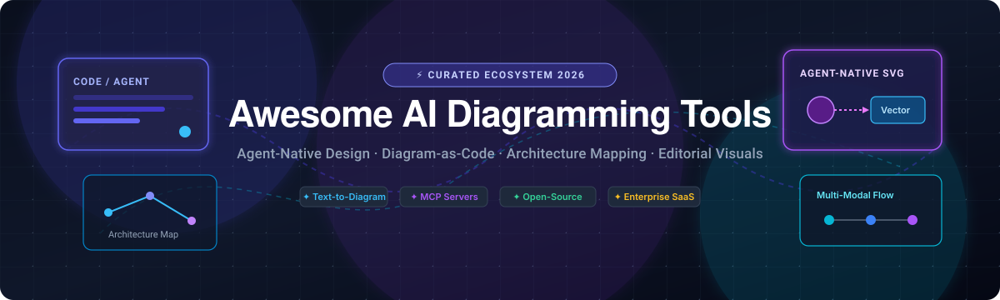

# Awesome AI Diagramming Tools 🎨🤖

  

  
  
  
  
  

---

## 🌟 Top AI Diagramming Tools Ecosystem

**Curated Index of SaaS Platforms & Open-Source GitHub Projects for Architecture Diagrams, Mind Maps, Flowcharts & Diagram-as-Code** 📊⚡

*Focused on Editorial Diagram Generation, Agent-Native Design, MCP Server Connectors & Code-to-Visual Pipelines.*

> 💡 **Welcome!** This repository tracks leading **SaaS platforms** and **open-source repositories** for modern **AI Diagramming Tools**. Whether you are leveraging LLMs to generate system topologies, connecting IDE coding agents (Claude Code, GitHub Copilot, Cursor) via MCP servers, or building automated documentation CI/CD pipelines, this guide covers the complete landscape.

---

## 📑 Table of Contents

- [📈 Sector Overview & Market Dynamics](#-sector-overview--market-dynamics)
- [🏢 SaaS / Hosted Platforms](#-saas--hosted-platforms)
- [💻 Open-Source GitHub Projects](#-open-source-github-projects)
- [🛠️ Architectural Patterns & Agent-Native Workflows](#️-architectural-patterns--agent-native-workflows)
- [🤝 How to Contribute](#-how-to-contribute)
- [💖 Support](#-support)
- [⭐ Star History](#-star-history)
- [⚠️ Disclaimer](#️-disclaimer)

---

## 📈 Sector Overview & Market Dynamics

The global diagramming and visual collaboration software market is estimated at **$4.5B to $6.0B** (with dedicated diagramming tools at ~$1.5B–$1.8B and collaborative visual workspaces/whiteboards at ~$3.5B–$4.1B, expanding at a 10%–15% CAGR). The sector is **moderately concentrated at the enterprise layer**, dominated by foundational platform giants (Microsoft, Miro, Lucid) that hold enterprise-wide procurement contracts and security agreements, while simultaneously exhibiting a vibrant, fragmented long-tail of specialized niche, indie, and developer-focused text-to-visual tools.

---

## 🏢 SaaS / Hosted Platforms

| Platform | Company Size (Valuation / Revenue) | Pricing (Starting Tier) | Free Tier Limits | Key Highlights |
| :--- | :--- | :--- | :--- | :--- |
| **[Microsoft Visio](https://www.microsoft.com/en-us/microsoft-365/visio/)** 🔷 | **~$3.1 Trillion** market cap / $245B+ rev (Microsoft parent) | $5.00/user/month (Visio Plan 1, annual billing) | 30-day free trial for Visio Plan 1/2; or Visio in M365 included with commercial M365 licenses (basic browser editing, limited templates) | Deep Microsoft 365 ecosystem integration, enterprise data-linking, industry-standard compliance and governance. |
| **[Lucidchart](https://www.lucidchart.com/)** 🔶 | **$3.0 Billion** valuation / ~$200M+ ARR (Lucid Software) | $7.95/user/month (Individual plan, annual billing) | 3 editable documents, capped at 60 shapes per document, 100 basic templates | The web diagramming benchmark with robust enterprise integrations (ServiceNow, LeanIX, Confluence, AWS). |
| **[Mural](https://www.mural.co/)** 🎨 | **$2.0 Billion** valuation / ~$100M–$125M ARR | $9.99/member/month (Team+ plan, annual billing) | 3 active murals, unlimited members, open workspace rooms only (no private rooms) | Facilitated visual collaboration platform tailored for workshops, agile ceremonies, and structured team design sprints. |
| **[Miro](https://miro.com/)** 🟡 | **$1.355 Billion** acquisition EV / ~$600M ARR (acquired by Bending Spoons) | $8.00/member/month (Starter plan, annual billing) | 3 editable boards, unlimited team members, 10 AI credits per month, public team boards only | Dominant visual canvas and whiteboarding platform with extensive diagramming templates and AI widgets. |
| **[Gliffy](https://www.gliffy.com/)** 🧩 | **~$100M+** (subsidiary of Perforce Software, private PE-backed) | $8.00/user/month (up to 50 users for Confluence Cloud, annual) / $10.00/mo standalone | Free for up to 10 users on Atlassian Confluence/Jira Cloud; 14-day free trial on standalone cloud | Native Confluence and Jira diagramming integration with intuitive drag-and-drop modeling. |
| **[Whimsical](https://whimsical.com/)** ⚡ | **~$100M–$250M** valuation / ~$7M+ ARR | $10.00/editor/month (Pro plan, annual billing) | 50 board objects/month, 50 doc blocks/month, 10 one-time AI credits, unlimited boards & viewers | High-speed, minimalist canvas combining flowcharts, wireframes, mind maps, and docs with clean aesthetics. |
| **[Cacoo](https://cacoo.com/)** 🌐 | **~$50M–$55M** market cap / ~$28M–$30M rev (Nulab, TYO: 5033) | $6.00/user/month (Pro/Team plan, annual billing) | 6 sheets (diagrams) total, unlimited users, PNG export only, 14-day trial for paid tiers | Real-time collaborative diagramming with multi-user cursors and Confluence/Jira/Google Drive integrations. |
| **[Draw.io Pro (Atlassian)](https://www.drawio.com/)** 🔄 | **~$15M–$30M** estimated commercial rev (independent draw.io Ltd / AG) | $5.00/month flat (11–20 users on Confluence Cloud) scaling tiered | Free forever for teams of up to 10 users on Atlassian Confluence/Jira Cloud; web standalone is 100% free | Commercial Atlassian marketplace plugin for the Apache-2.0 draw.io/diagrams.net core engine. |
| **[Creately](https://creately.com/)** 🧠 | **~$10M–$20M** estimated valuation / ~$5.1M ARR (Cinergix) | $5.00/user/month (Starter plan, annual billing) | Unlimited canvases & collaborators, capped at 45 items/shapes per canvas, 1 folder, JPEG/PNG export only | Multi-purpose visual workspace with AI modeling assistants and extensive template libraries. |
| **[MindMeister](https://www.mindmeister.com/)** 🗺️ | **Bootstrapped SMB** / ~$5M–$10M ARR (MeisterLabs) | $6.00/user/month (Personal plan, annual billing) | 3 mind maps total, real-time collaboration, no export options (PDF/Word/image exports locked) | Dedicated structured mind mapping tool integrated with MeisterTask project management. |

---

## 💻 Open-Source GitHub Projects

*Sorted in descending order by GitHub Stars.* 🌟

1. ### **[Excalidraw](https://github.com/excalidraw/excalidraw)**  ✏️
   - **Stars:** ~134k+ | **License:** MIT
   - **Virtual whiteboard for sketching hand-drawn-like diagrams.** The premier open-source sketching tool for technical diagrams, system design, and brainstorming. Features arrow binding for connected diagrams, multi-point lines, free-hand drawing, dark mode, and grid alignment. Includes a React component package (`@excalidraw/excalidraw`) for embedding directly in web applications, plus an active ecosystem of Obsidian, VS Code, and JetBrains extensions.

2. ### **[Mermaid](https://github.com/mermaid-js/mermaid)**  🧜‍♀️
   - **Stars:** ~91k+ | **License:** MIT
   - **JavaScript-based diagramming and charting from Markdown-inspired text definitions.** The de facto standard for diagram-as-code in technical documentation. Directly supported in GitHub, GitLab, Notion, and Azure DevOps markdown files. Enables generation of flowcharts, sequence diagrams, state diagrams, class diagrams, Gantt charts, and Git graphs directly from version-controlled source text.

3. ### **[draw.io Desktop](https://github.com/jgraph/drawio-desktop)**  🖥️
   - **Stars:** ~64k+ | **License:** Apache-2.0
   - **Offline desktop build of diagrams.net (draw.io).** Runs locally across macOS, Windows, and Linux via Electron. Delivers full privacy and complete offline capability without third-party cloud dependencies. Supports custom shape libraries, offline font rendering, and seamless import/export of `.drawio` files, SVGs, and PDFs.

4. ### **[Diagram Design](https://github.com/cathrynlavery/diagram-design)**  📐
   - **Stars:** ~56k+ | **License:** MIT
   - **Editorial diagram design tuned for coding agents.** Specifically engineered for Claude Code, Codex, GitHub Copilot, Factory Droid, and Pi—focused on delivering crisp, publication-grade visuals ("No shadows, no Mermaid slop"). Supports 42 diagram types with self-contained HTML + SVG output, brand token extraction, and cross-agent installation via `npx skills add cathrynlavery/diagram-design`.

5. ### **[tldraw](https://github.com/tldraw/tldraw)**  🖊️
   - **Stars:** ~51k+ | **License:** Apache-2.0 / Commercial
   - **Tiny, delightful canvas and infinite whiteboard library.** Written in TypeScript and React, tldraw serves as a foundational engine for custom AI whiteboarding experiments, multimodal canvas bots (e.g., Make Real / Draw-a-UI), and embeddable visual editors with multiplayer synchronization.

6. ### **[Diagrams (Python)](https://github.com/mingrammer/diagrams)**  🐍
   - **Stars:** ~43k+ | **License:** MIT
   - **Diagram as Code for prototyping cloud system architectures.** Generate cloud architecture visuals across AWS, Azure, GCP, Kubernetes, Alibaba Cloud, and on-premise infrastructure using clean, declarative Python code. Backed by Graphviz for deterministic automated layouts.

7. ### **[D2](https://github.com/terrastruct/d2)**  💎
   - **Stars:** ~26k+ | **License:** MPL-2.0
   - **Modern declarative diagram scripting language.** D2 turns plain text descriptions into beautiful diagrams with pluggable layout engines (TALA, Dagre, ELK). Designed with human-readable syntax, nested diagrams, auto-formatting, SQL tables, class definitions, and code snippet embeddings.

8. ### **[PlantUML](https://github.com/plantuml/plantuml)**  🌲
   - **Stars:** ~13k+ | **License:** GPL / LGPL / Apache / MIT
   - **The gold standard for text-to-UML generation.** Robust syntax supporting sequence, use-case, class, activity, component, state, and deployment diagrams. Backed by decades of battle-tested tooling, CI/CD plugins, IDE extensions, and server-side renderers.

9. ### **[bpmn-js](https://github.com/bpmn-io/bpmn-js)**  ⚙️
   - **Stars:** ~9.7k+ | **License:** bpmn.io license
   - **BPMN 2.0 diagramming toolkit and web modeler.** Built with JavaScript for embedding in modern web applications. Provides complete interactive editing, viewing, and automated traversal for enterprise workflows and business process notation.

10. ### **[draw.io Web Core](https://github.com/jgraph/drawio)**  🌐
    - **Stars:** ~8.8k+ | **License:** Apache-2.0
    - **Core open-source repository for diagrams.net.** Independent and privacy-first web diagramming application storing zero data on proprietary servers. Diagrams remain locally stored or sync directly to Google Drive, OneDrive, GitHub, or GitLab.

11. ### **[Mermaid CLI](https://github.com/mermaid-js/mermaid-cli)**  💻
    - **Stars:** ~5.1k+ | **License:** MIT
    - **Command-line interface for Mermaid.** Compiles `.mmd` text definitions to SVG, PNG, and PDF headlessly using Puppeteer. Essential for CI/CD documentation pipelines and automated release documentation generation.

12. ### **[Kroki](https://github.com/yuzutech/kroki)**  🚀
    - **Stars:** ~4.4k+ | **License:** MIT
    - **Unified gateway and microservice for diagram-as-code.** Provides a single HTTP API to render diagrams written in Mermaid, PlantUML, D2, Graphviz, BlockDiag, BPMN, Bytefield, C4, Erd, Excalidraw, Nomnoml, Pikchr, Structurizr, SVGBob, Vega, WaveDrom, and WireViz.

13. ### **[PlantUML Server](https://github.com/plantuml/plantuml-server)**  🖧
    - **Stars:** ~2.2k+ | **License:** GPL-3.0
    - **Lightweight web application and Dockerized microservice for on-demand PlantUML rendering.** Directly generates SVG and PNG diagrams via HTTP GET/POST queries.

14. ### **[excalidraw-converter](https://github.com/sindrel/excalidraw-converter)**  🔄
    - **Stars:** ~294 | **License:** MIT
    - **CLI utility for porting Excalidraw diagrams to Gliffy and draw.io format.** Bridges hand-drawn brainstorming sessions into formal enterprise diagramming files.

15. ### **[excalidraw-self-hosted](https://github.com/Someone0nEarth/excalidraw-self-hosted)**  🐳
    - **Stars:** ~168 | **License:** MIT
    - **Docker-compose configuration for a fully private self-hosted Excalidraw stack.** Includes web frontend, local storage backend, and websocket multiplayer sharing room.

16. ### **[system-design-templates-excalidraw](https://github.com/aretecode/system-design-templates-excalidraw)**  📐
    - **Stars:** ~123 | **License:** Open
    - **Curated collection of system design primitives and shapes.** Rapid wireframes and components for distributed systems, microservices, databases, caches, and frontend architectures.

17. ### **[excalidraw-jetbrains-plugin](https://github.com/bric3/excalidraw-jetbrains-plugin)**  🧩
    - **Stars:** ~103 | **License:** Apache-2.0
    - **JetBrains IDE integration.** View, create, and modify Excalidraw files directly within IntelliJ IDEA, CLion, WebStorm, PyCharm, and GoLand.

18. ### **[Zenuml Core](https://github.com/mermaid-js/zenuml-core)**  🧘
    - **Stars:** ~69 | **License:** MIT
    - **Sequence diagram generator with code-like syntax.** Focuses on developer ergonomics, object interactions, message dispatch, and synchronous/asynchronous logic mapping.

19. ### **[vscode-excalidraw](https://github.com/brijeshb42/vscode-excalidraw)**  💻
    - **Stars:** ~32 | **License:** MIT
    - **Visual Studio Code extension for Excalidraw.** Allows developers to sketch system designs and flowcharts without leaving their editor workspace.

20. ### **[drawio-mcp](https://github.com/yohasacura/drawio-mcp)**  🤖
    - **Stars:** ~5 | **License:** MIT
    - **Model Context Protocol (MCP) server for programmatic draw.io generation.** Connects coding agents (Claude Desktop, Cursor, GitHub Copilot) to generate, edit, auto-layout, and polish `.drawio` files directly from codebase inspections.

---

## 🛠️ Architectural Patterns & Agent-Native Workflows

To build a modern, high-velocity diagramming stack for software engineering teams:
- 🤖 **Agent-Native Generation:** Use **Diagram Design** and **drawio-mcp** to enable coding agents to output clean SVG and native XML diagrams directly from AST or repository inspections.
- 📝 **Diagrams as Code:** Use **Mermaid**, **D2**, or **Diagrams (Python)** in source repositories to track architecture diagrams with Git version control and pull request reviews.
- 🎨 **Brainstorming & Prototyping:** Use **Excalidraw** or **tldraw** for collaborative whiteboarding and system design interviews.
- 🏢 **Enterprise Documentation & Governance:** Bridge diagrams into **Lucidchart**, **Microsoft Visio**, or **draw.io Atlassian Suite** for corporate compliance and multi-stakeholder approval.

---

## 🤝 How to Contribute

Contributions are welcome! To propose a new tool, update pricing, or refine descriptions:

1. 🍴 Fork the repository.
2. 📝 Update `README.md` following the established format and guidelines.
3. 🔗 Include official documentation links, pricing details, and free tier limitations for SaaS products, or GitHub star badges for open-source tools.
4. 🚀 Submit a pull request with a concise description of your additions.

---

## 💖 Support

If you find this curated ecosystem directory helpful, consider supporting its maintenance!

- ⭐ **Star** this repository on GitHub
- 🍴 **Fork** and share it with your engineering team
- ☕ **Sponsor or Buy a Coffee:** [GitHub Sponsors Dashboard](https://github.com/sponsors/ishandutta2007)

Thank you to all community contributors, builders, and maintainers! 🙌

---

## 📊 Star History

---

## ⚠️ Disclaimer

- This is an independent, community-curated list for research and evaluation purposes.
- Tools handling proprietary architecture diagrams or intellectual property should be reviewed for internal data governance and compliance.
- Open-source tools like draw.io and Mermaid provide production-ready, vendor-independent alternatives with zero data retention on external servers.

---

  <b>Built for technical architects, developers, and AI engineers shaping visual engineering pipelines.</b>

